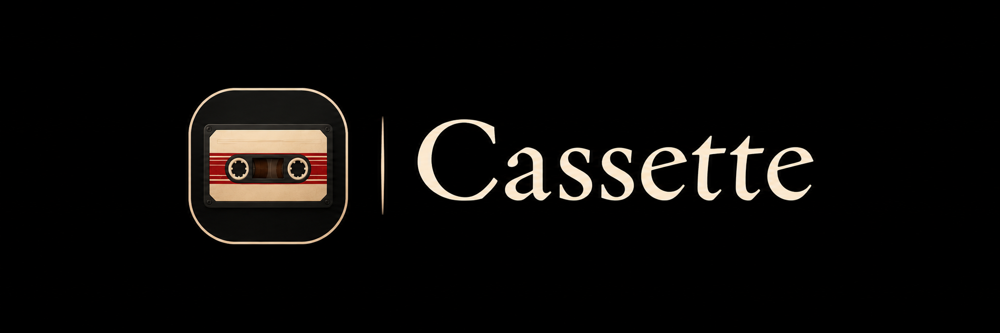
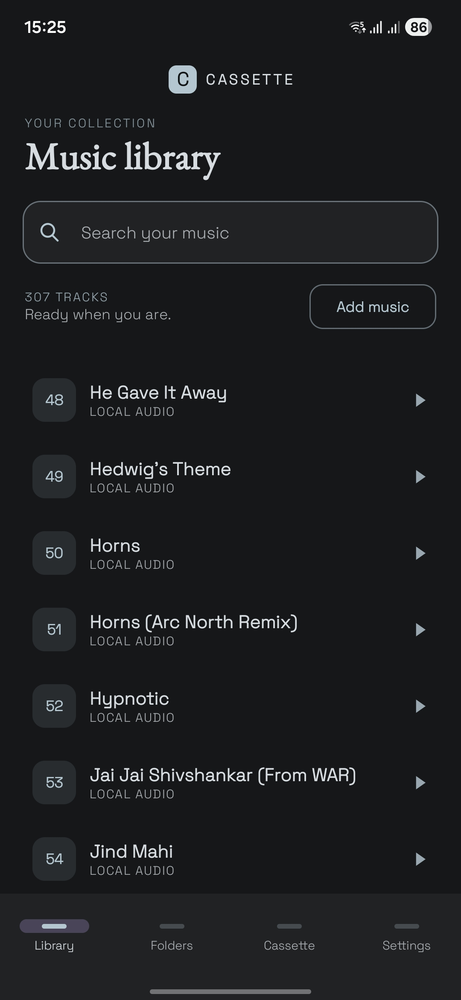
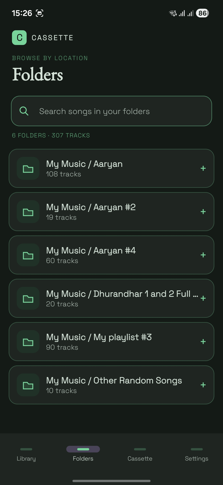
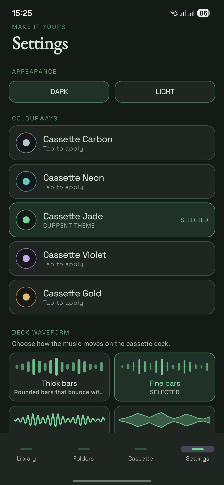

<div align="center">

  

  **A local music player for Android.**

  [](https://github.com/Aaryan047/Cassette/stargazers)
  [](https://github.com/Aaryan047/Cassette/forks)
  [](https://github.com/Aaryan047/Cassette/commits/main)

</div>

---

## About

Cassette is an Android music player built around a simple idea: your music should be easy to access, even when you're offline.

It focuses on music stored locally on your device, with a clean library, folder-based browsing, a dedicated cassette deck, and audio-reactive visualisers.

I started building Cassette because I wanted a local music player that felt considered to use, not just functional. The project has also been a way to explore Android development, audio processing, and interface design.

## Features

- **Local music playback** - play audio stored on your device.
- **Offline listening** - your local music does not need an internet connection.
- **Music library** - browse and search your music collection.
- **Folder browsing** - find tracks by their location on your device.
- **Cassette deck** - a dedicated landscape playback screen.
- **Audio-reactive visualisers** - visual styles that respond to the music.
- **Five visualiser styles** - Thick Bars, Fine Bars, Squiggle, Mirror, and Dots.
- **Five colour themes** - Carbon, Neon, Jade, Violet, and Gold.
- **Light and dark appearance** - both variants are available for each theme.
- **Playback controls** - shuffle, repeat, previous, next, and seeking.

## Screenshots

### Music library

<div align="center">
  
</div>

### Folder browsing

<div align="center">
  
</div>

### Settings and themes

<div align="center">
  
</div>

## Themes

Cassette currently includes five colour themes:

| Theme | Description |
|:---|:---|
| Carbon | Neutral, understated tones |
| Neon | Contrasting accent colours |
| Jade | Green-inspired palette |
| Violet | Purple-inspired palette |
| Gold | Warm golden tones |

Each theme has a light and a dark variant.

## Visualiser styles

The cassette deck includes five visualiser styles:

- **Thick Bars**
- **Fine Bars**
- **Squiggle**
- **Mirror**
- **Dots**

The visualiser analyses the audio being played and uses it to drive the on-screen animation.

## Built with

- **Kotlin** - programming language
- **Jetpack Compose** - Android UI
- **AndroidX Media3 / ExoPlayer** - audio playback
- **Android audio processing APIs** - audio analysis for the visualiser
- **Gradle** - build system

## Download

Want to try Cassette? Download the Android APK directly:

<div align="center">

  **[Download Cassette for Android](https://github.com/Aaryan047/Cassette/raw/refs/heads/main/cassette.apk)**

  <sub>Download the APK, open it on your Android device, and follow the installation prompt.</sub>

</div>

If Android blocks the installation, allow your browser or file manager to install unknown apps when prompted. Only install APKs you trust.

The download link expects `cassette.apk` to be uploaded to the root of this repository.

## Build from source

### Requirements

- Android Studio
- Android SDK required by the project
- A JDK version compatible with the project's Gradle configuration

### Clone the repository

```bash
git clone https://github.com/Aaryan047/Cassette.git
```

Open the cloned project in Android Studio, allow Gradle to sync, and run the `app` configuration on an Android device or emulator.

## Feedback and contributions

Cassette is a personal project, but feedback, bug reports, and contributions are welcome.

If you run into a problem, open an issue and include your Android version, device model, and steps to reproduce it where possible.

## Roadmap

Things I'd like to keep improving:

- Playback reliability and performance.
- More visualiser refinements.
- Library and folder-browsing improvements.
- UI polish and accessibility.

## Acknowledgements

Cassette is built with Kotlin, Jetpack Compose, and AndroidX Media3.

Thanks to the Android developer community and the maintainers of the libraries used in this project.

## License

No open-source licence has been added yet. Until a licence is included in the repository, all rights are reserved by the copyright holder. Please do not assume the code is available for reuse or redistribution.
